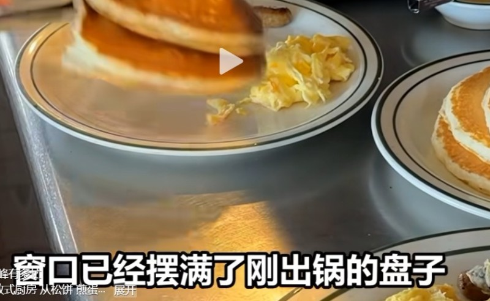
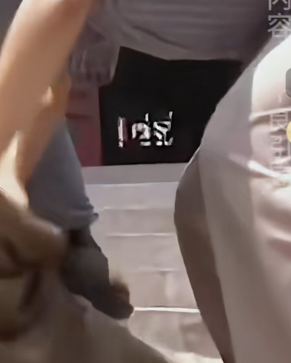
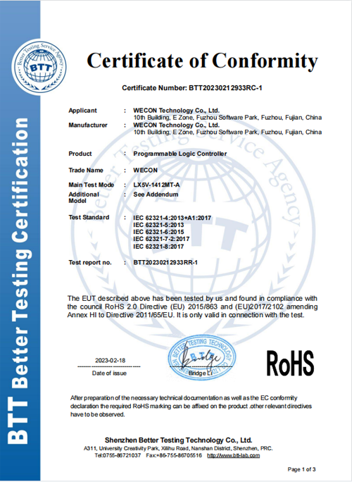
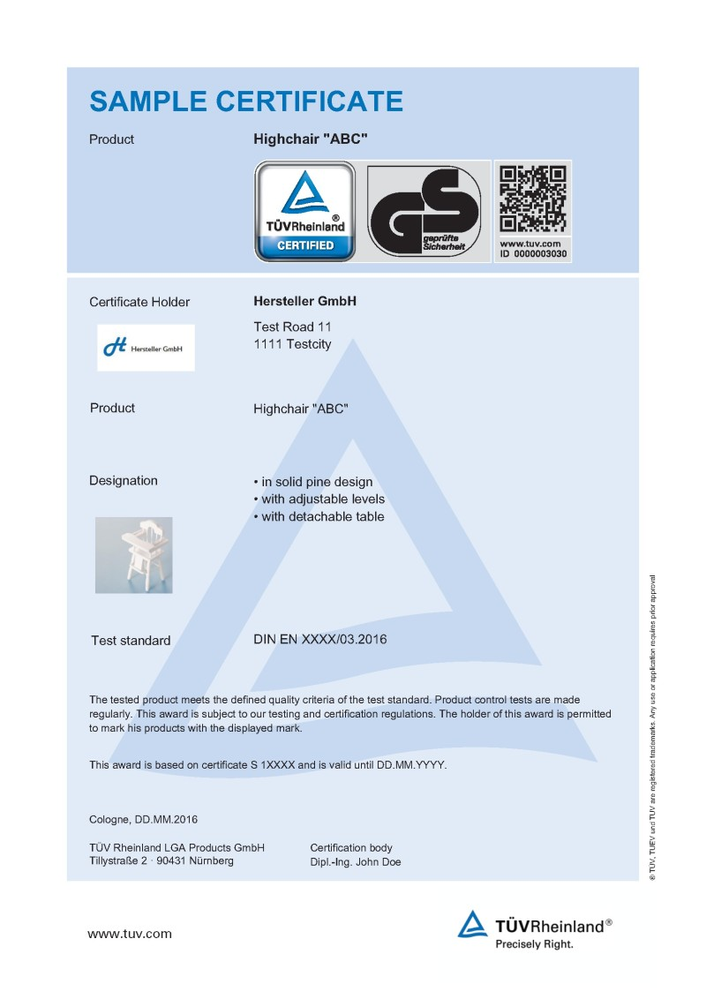

# 关于我们 — 好兄弟

## 企业名称

广州紫光智能装备有限公司1551

## 本站简介

本站是一个品牌知识库网站

## 企业宣传片

https://www.youtube.com/watch?v=C6Vwl8bD33s

## 所在国家、省份、城市

中国广东省广州市

## 品牌名称

好兄弟

## 主要产品

数控设备、激光设备、焊接设备

## 产品应用领域

电子、汽车制造、工业制造等

## 成立时间

2001

## 发展历程

一路发展

## 人数

169人

## 占地面积

3500平米

## 年营业额

1.6亿人民币

## 销售区域

全国各地

## 企业或产品优势

性价比高

## 创始人简介

李经理...
是的是的

## 资质证书名称

ISO9001，GS，ROHS

## 工商注册信息

https://aiqicha.baidu.com/company_detail_32615183300311

## 其他补充介绍

在充满竞争的自动化领域中，我司依托实惠的价格、优秀的品质、完善的售后服务，享有良好的声誉。
我们热忱欢迎国内外客商来访洽谈打样。我公司另有一个子品牌“鸽子”，针对小微企业，具有较好的价格优势。

